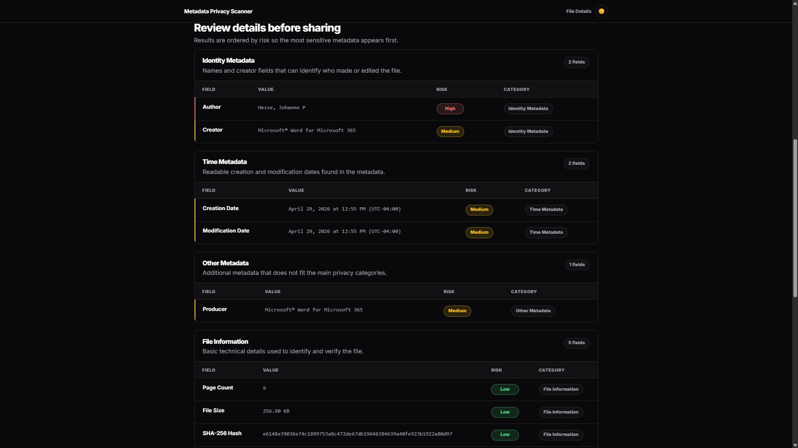
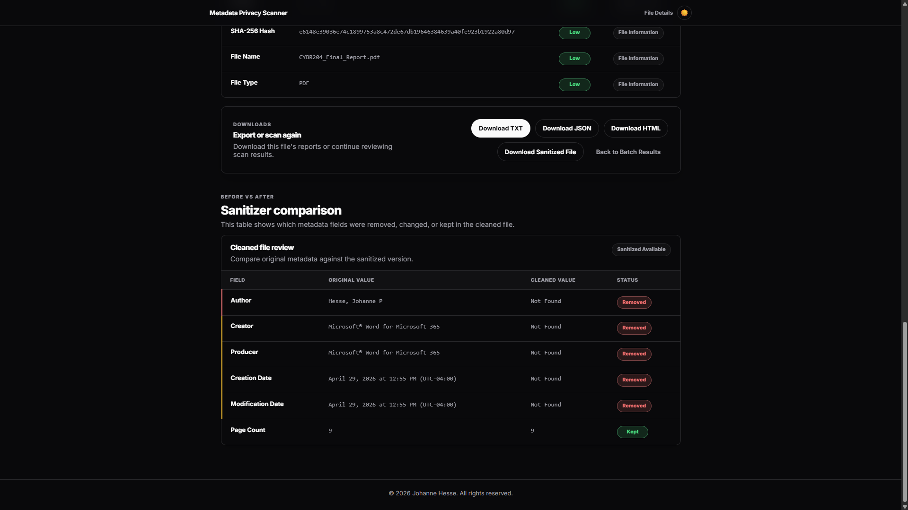

# Metadata Privacy Scanner

Flask app for finding privacy-sensitive metadata in image, PDF, and DOCX files, with explainable risk scoring, metadata sanitization, and downloadable reports.


## What it does

Upload one file or a batch of JPG, JPEG, PNG, PDF, and DOCX files. The app validates filename, extension, and file signature; enforces a 10 MiB request limit; and caps Pillow image dimensions at 25 million pixels.

| File type | Metadata extraction | Sanitization |
| --- | --- | --- |
| JPG, JPEG, PNG | ExifTool when installed; Pillow fallback | Re-save image without EXIF metadata |
| PDF | PyMuPDF document properties | Clear common document properties where supported |
| DOCX | `python-docx` core properties | Blank core properties where supported |

Each scan includes a SHA-256 digest of the uploaded file's bytes. This identifies file content; it is not a privacy-risk indicator and does not prove file authenticity.

## Scan flow

`Upload → validate → extract metadata + SHA-256 → classify fields and score risk → show findings → optionally sanitize and download reports`

Metadata fields receive Low, Medium, or High classifications. The numeric score adds 15 points per Medium field and 35 per High field, capped at 100. The displayed level is Low when there are no Medium/High fields, Medium when there is at least one Medium field and no High field, and High when any High field exists. See [risk-scoring details](docs/risk-scoring.md).

The results page groups metadata, explains detected risks, and provides recommendations. Scans can generate TXT, JSON, and HTML reports. Sanitized output and before/after metadata comparison are available when cleaning succeeds.

## Privacy and storage

The upload form offers auto-delete. When enabled, the uploaded source file is removed after its scan, including error paths. Generated reports and cleaned files remain on disk for download; auto-delete does not remove them. Without auto-delete, uploaded files remain in `uploads/`. The app does not provide authentication or persistent scan history; do not expose it publicly without adding appropriate access controls and storage lifecycle controls.

`uploads/`, `reports/`, and `cleaned/` are mounted as local folders by Docker Compose. Their generated contents are ignored by Git.

## Screenshots

| Scan results | High-risk metadata | Sanitization comparison |
| --- | --- | --- |
|  |  |  |

More: [metadata table and downloads](screenshots/low-risk-metadata-and-downloads.png), [homepage](screenshots/homepage.png), [results page](screenshots/results-page.png).

## Run locally

Requires Python 3.12 as used by CI. Install dependencies and start Flask:

```bash
python -m venv .venv
source .venv/bin/activate
pip install -r requirements.txt
python app.py
```

PowerShell activation:

```powershell
python -m venv .venv
.\.venv\Scripts\Activate.ps1
pip install -r requirements.txt
python app.py
```

Open <http://localhost:5000>.

## Docker

```bash
docker compose up --build
```

Compose maps port 5000 and mounts the generated uploads, reports, and cleaned files to local folders. For a non-local deployment, set a strong `SECRET_KEY` and add authentication and suitable retention controls; the included Compose default is for local development.

## Tests

```bash
python -m pip install -r requirements.txt
python -m pytest -q
```

GitHub Actions runs `pytest` on pushes and pull requests using Python 3.12.
