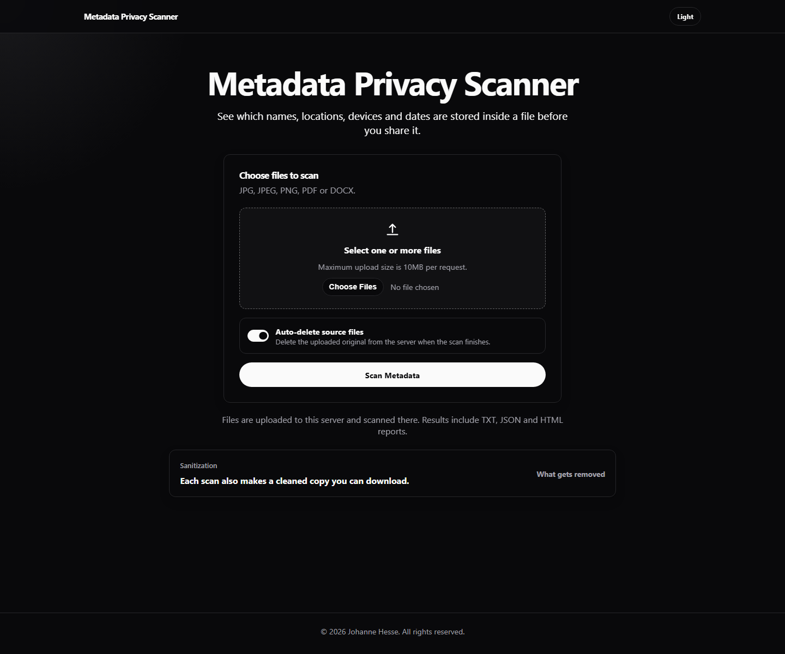
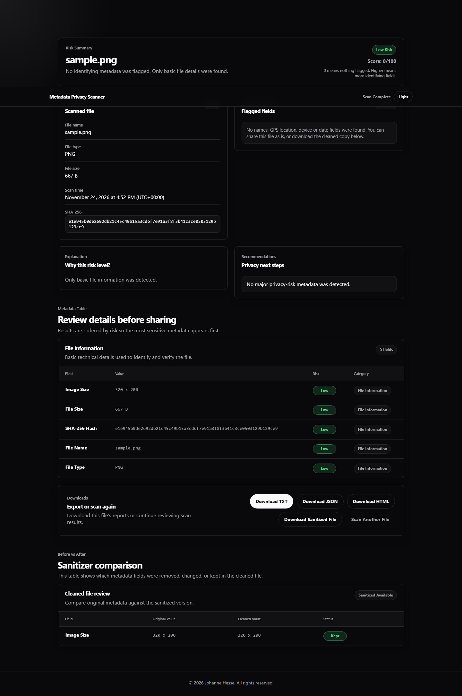

# Metadata Privacy Scanner

Flask app that finds privacy-sensitive metadata in image, PDF, and DOCX files, scores the risk, removes metadata, and produces downloadable reports.



## What it does

- Scans one file or a batch of JPG, JPEG, PNG, PDF, and DOCX files.
- Lists metadata grouped as identity, location, device, time, file information, and other.
- Rates each field Low, Medium, or High and gives a 0-100 risk score with an explanation and recommendations.
- Writes a cleaned copy of the file and shows a before/after metadata comparison when cleaning succeeds.
- Generates TXT, JSON, and HTML reports for each scan.

| File type | Metadata extraction | Cleaning |
| --- | --- | --- |
| JPG, JPEG, PNG | ExifTool when installed; Pillow fallback | Copy pixel data into a new image and save it without EXIF |
| PDF | PyMuPDF document properties | Clear PDF document metadata |
| DOCX | `python-docx` core properties | Blank author, last modified by, title, and subject; clear created and modified dates where supported |

## How it works

1. Validate the upload: allowed extension, safe filename, and a file signature that matches the extension. Requests are limited to 10 MiB, and Pillow's decompression-bomb limit is set to 25 million pixels.
2. Extract metadata and compute a SHA-256 digest of the file bytes.
3. Classify each field and calculate the risk score.
4. Clean the file, re-scan the cleaned copy, and write the reports.

### Risk scoring

| Level | Fields | Points each |
| --- | --- | --- |
| High | GPS latitude/longitude (any field containing "gps"), author, last modified by, camera make, camera model | 35 |
| Medium | Software, creator, producer, creation and modification dates (any field containing "date" or "time") | 15 |
| Low | Everything else, such as file size, file type, page count, image size, and SHA-256 hash | 0 |

The score is capped at 100. The overall level is High if any High field is present, Medium if at least one Medium field and no High field is present, and Low otherwise. See [docs/risk-scoring.md](docs/risk-scoring.md).

### SHA-256

The SHA-256 digest identifies the exact file content. It is classified Low, does not affect the score, and does not prove the file is authentic.

## Privacy and storage

- Auto-delete is on by default in the upload form. When enabled, the uploaded file is deleted after its scan, including when the scan fails. Without it, uploads stay in `uploads/`.
- Reports in `reports/` and cleaned files in `cleaned/` stay on disk for download. Auto-delete does not remove them.
- Batch results are held in memory for 1 hour. There is no persistent scan history.
- The app has no authentication. Do not expose it publicly without adding access control and file retention rules.

## Screenshots

| Scan results | High-risk metadata | Sanitization comparison |
| --- | --- | --- |
|  |  |  |

More: [metadata table and downloads](screenshots/low-risk-metadata-and-downloads.png), [homepage](screenshots/homepage.png), [results page](screenshots/results-page.png).

## Setup

Requires Python 3.12, the version used in CI. ExifTool is optional; without it, images are read with Pillow.

```bash
python -m venv .venv
source .venv/bin/activate        # PowerShell: .\.venv\Scripts\Activate.ps1
pip install -r requirements.txt
```

### Docker

```bash
docker compose up --build
```

The image installs ExifTool and runs the app with gunicorn on port 5000. Compose mounts `uploads/`, `reports/`, and `cleaned/` as local folders. The default `SECRET_KEY` in Compose is for local use only; set your own for any other deployment.

## Usage

```bash
python app.py
```

Open <http://localhost:5000>, choose one or more files, and submit. A single file opens its results page. A batch opens a summary with a link to each file's results. Reports and the cleaned file are downloaded from the results page.

## Tests

```bash
python -m pytest -q
```

The tests cover upload validation, file signature checks, date formatting, GPS conversion, risk scoring, metadata grouping, report generation, image cleaning, batch results, and batch cleanup. GitHub Actions runs `pytest` on Python 3.12 for every push and pull request.

## Project structure

```text
app.py              Flask routes, metadata extraction, risk scoring, cleaning, reports
templates/          Jinja templates
static/             CSS and JavaScript
docs/               Risk scoring and project overview
tests/              pytest tests
screenshots/        README screenshots
uploads/ reports/ cleaned/   Runtime output folders (contents ignored by Git)
```
